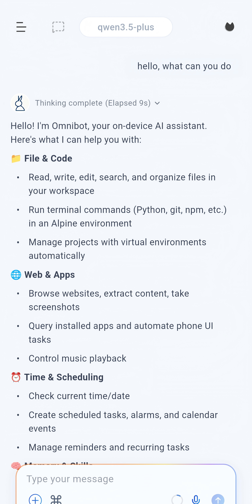
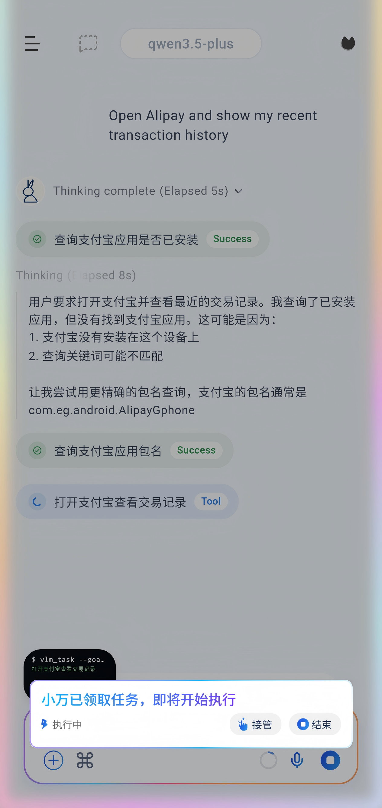
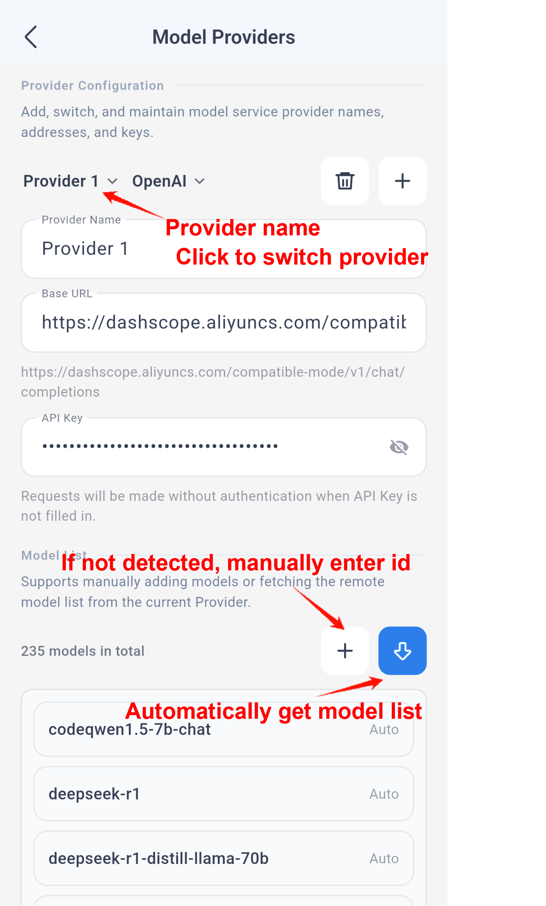
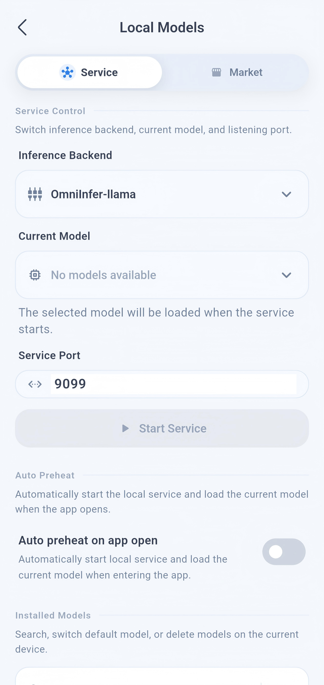
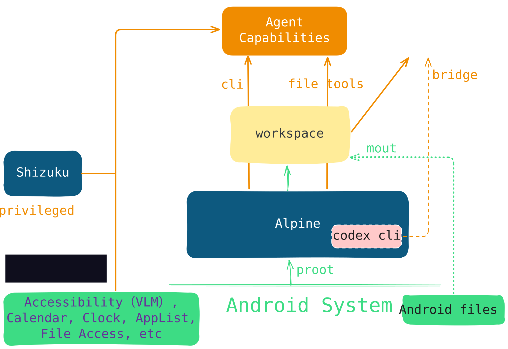

<div align="center">
  

# MyAgent · 端侧 AI 助手

**Android 端侧 AI Agent —— 理解 → 决策 → 执行 → 反思的完整闭环**

*An on-device AI agent that operates your phone like a human: apps, gestures, and system settings.*


</div>

> 本项目是 **[OpenOmniBot](https://github.com/omnimind-ai/OpenOmniBot)**（AGPL v3）的**深度融合开发版**。
> 上游提供了端侧 Agent 的骨架；本仓库的绝大部分代码是**我重写的** —— 实测 **574 个 Kotlin/Java 文件 / 71,092 行** + **390 个 Dart 文件 / 134,514 行**，
> 核心模块（Agent 编排、记忆系统、浏览器自动化、视觉检测）基本全部重写，详见「我重写了什么」。

## 📖 项目简介

MyAgent 是一个运行在 Android 设备上的端侧 AI Agent。与传统 AI 聊天应用不同，它不止于"对话"，而是关注 **从理解 → 决策 → 执行 → 反思的完整闭环**：理解用户意图，规划任务步骤，直接操作手机界面（App、手势、系统设置），并根据执行结果自我修正。

- **端侧运行**：支持本地模型推理（llama.cpp / MNN 后端），敏感数据不出设备
- **真机操作**：无障碍服务 + 视觉语言模型（VLM）理解屏幕，像真人一样操作手机
- **可扩展**：技能系统、MCP、Alpine 环境、内置终端、浏览器

## ✨ 核心能力

| 能力 | 说明 |
|---|---|
| 🧠 **端侧模型推理** | 本地运行 LLM/VLM（OmniInfer 运行时，llama / MNN 双后端），支持模型下载管理与自动预热 |
| 📱 **手机任务自动化** | 通过无障碍服务与视觉模型理解屏幕内容，自动操作 App、手势与系统设置，支持任务接管与中断 |
| 🛠 **技能系统** | 发送仓库链接即可安装技能（Skill），能力持续扩展；内置技能商店 |
| 🧩 **工具生态** | 文件读写、工作区浏览、浏览器操作、内置 Linux 终端（Alpine）、MCP 集成 |
| 💾 **记忆系统** | 短期 + 长期记忆，支持嵌入（Embedding）检索 |
| ⏰ **任务与调度** | 定时任务、子代理流程、闹钟、日历创建/查询/修改、音频播放控制 |
| 🤖 **Codex 集成** | App 内直接连接 Codex App Server，支持多线程会话与斜杠命令 |
| 🎨 **原生体验融合** | 悬浮球与半屏表面（Overlay）、Flutter 与原生 Kotlin 混合渲染 |

## 🛠 我重写了什么

上游给的是"能跑起来的骨架"，这个项目真正的价值在于**把它改造成能干活的 Agent**。以下是我逐块重写或新建的部分：

### 1. Agent 编排层（重写）

| 文件 | 行数 | 作用 |
|---|---|---|
| `AssistsCoreManager.kt` | 5,921 | 自动化引擎总控：任务状态机、视觉检测调度、执行控制 |
| `AgentToolDefinitions.kt` | 2,323 | 工具定义层：每个工具的参数 schema 与描述（Agent 靠它决定调什么） |
| `AgentConversationHistorySupport.kt` | 1,862 | 对话历史管理、上下文裁剪 |
| `AgentWorkspaceManager.kt` | 938 | Agent 工作区（文件读写、目录浏览） |
| `chat_conversation_runtime_coordinator.dart` | 3,194 | Flutter 侧对话运行时协调：流式渲染、状态同步、中断处理 |

### 2. 视觉检测子系统（重写）

自研的**图标 / 按钮 / 页面元素**检测器，让 Agent 不依赖固定坐标也能找到目标：

| 文件 | 行数 |
|---|---|
| `detectors/icon/IconDetector.kt` | 2,215 |
| `detectors/button/CloseButtonDetector.kt` | 1,811 |
| `detection/`（整套检测框架） | — |

### 3. 浏览器自动化（新建）

`BrowserUseEngine.kt`（3,788 行）—— 让 Agent 真正能开浏览器、填表单、点按钮、读页面，而不只是操作 App 界面。

### 4. 记忆系统（重写）

`WorkspaceMemoryService.kt`（1,149 行）—— 短期 / 长期记忆 + 嵌入检索。让 Agent 跨会话记住用户偏好，而不是每轮都失忆。

### 5. Codex App Server 集成（新建）

`CodexAppServerManager.kt`（1,126 行）—— App 内直接连 Codex App Server，多线程会话 + 斜杠命令。这是我加的扩展，上游没有。

### 6. 内嵌终端（集成第三方 + 改造）

`EmbeddedTerminalRuntime.kt`（1,698 行）—— 基于 [ReTerminal](https://github.com/RohitKushvaha01/ReTerminal)（MIT）接入 Alpine Linux 终端，让 Agent 有真正的 shell。

### 7. 自动化任务的 HTTP 控制面（新建）

`HttpController.kt`（2,593 行）—— 把整个自动化引擎暴露成 HTTP 接口，外部可以直接下发任务、查状态、拉执行日志。

---

## 📱 界面展示

<p align="center">
  
  
  
  
</p>

<p align="center">
  <sub>对话与工具调用 · 手机自动化任务 · 多服务商配置 · 本地模型推理</sub>
</p>

## 🏗 技术架构

<p align="center">
  
</p>

```text
myagent/
├── app/                        # Android 宿主：入口、Agent 编排、系统能力、MCP、服务
├── ui/                         # Flutter UI：对话、设置、任务、记忆与应用界面
├── baselib/                    # 共享基础库：数据库、存储、网络、模型配置、OCR、权限
├── assists/                    # 自动化引擎：任务调度、状态机、视觉检测、执行控制
├── accessibility/              # 无障碍与屏幕感知：无障碍服务、截图、投屏
├── omniintelligence/           # AI 抽象层：模型协议、任务状态、请求/响应模型
├── uikit/                      # 原生悬浮 UI：悬浮球、面板、半屏表面
├── third_party/omniinfer/      # 本地推理运行时（子模块）
└── ReTerminal/core/            # 内嵌终端模块（第三方组件，MIT）
```

## 🚀 构建

### 环境要求

- Flutter SDK `3.9.2+`
- JDK `11+`（推荐 17）
- Android SDK / NDK

### 获取代码

```bash
git clone https://github.com/soyoung5565/myagent.git
cd myagent

# 仅在构建完整 omniinfer 本地推理版时需要初始化子模块
git submodule update --init third_party/omniinfer
git -C third_party/omniinfer submodule update --init framework/mnn
git -C third_party/omniinfer submodule update --init framework/llama.cpp

cd ui && flutter pub get
```

### 构建并安装

```bash
cd ..

# standard 精简版（不含本地推理）
./gradlew :app:installDevelopStandardDebug -Ptarget=lib/main_standard.dart

# omniinfer 完整版（含本地推理）
./gradlew :app:installDevelopOmniinferDebug -Ptarget=lib/main_omniinfer.dart
```

> 如遇 `Could not read script '.../ui/.android/include_flutter.groovy'`，执行 `flutter clean && flutter pub get` 后重试。

## 🔗 与上游项目的关系

本仓库是 **[OpenOmniBot](https://github.com/omnimind-ai/OpenOmniBot)** 的融合开发版，基于 AGPL v3 协议。

- **协议**：保持上游的 AGPL v3 + 商业双许可，未修改（见 `LICENSE`）
- **自研比例**：核心模块（Agent 编排、记忆、浏览器自动化、视觉检测、HTTP 控制面）全部重写，上游只提供了工程骨架与模块划分
- **新增能力**：Codex App Server 集成、HTTP 任务控制面等为本人新增
- **子模块**：`third_party/omniinfer` 是本地推理运行时子模块，clone 后需 `git submodule update --init`

## 🙏 致谢

- [OpenOmniBot](https://github.com/omnimind-ai/OpenOmniBot) —— 本项目的基础框架与上游来源（AGPL v3）
- [ReTerminal](https://github.com/RohitKushvaha01/ReTerminal) —— 内嵌终端模块（MIT License）
- [OpenMinis / MinisSkills](https://github.com/OpenMinis) —— 技能生态

## 📄 License

详见 [LICENSE](LICENSE)。
